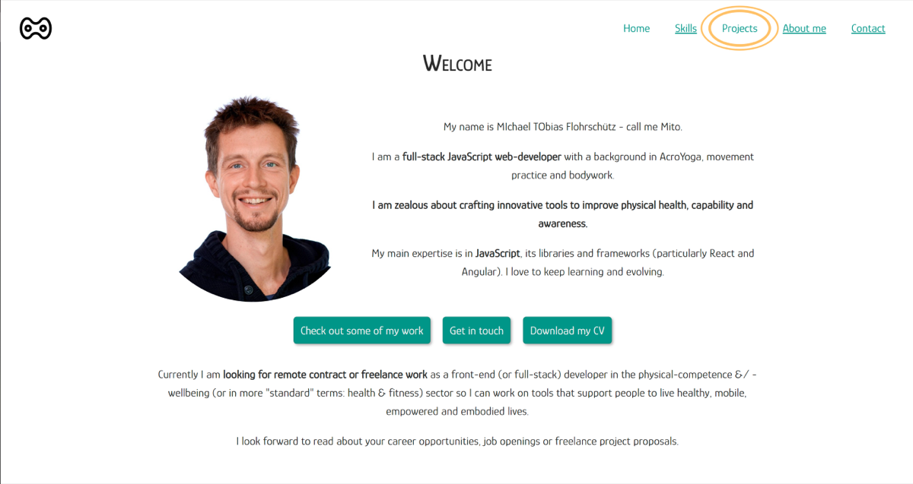

# Portfolio website

## Screenshot

## Production version
[View page here: MichaelFlohrschuetz.com](https://MichaelFlohrschuetz.com/)

This project started as a static website to learn HTML and CSS, but turned into a full-grown portfolio website.

## Built with
For practice reasons I chose to refrain from rebuilding it using libraries or build tools, so every line of code here is hand-written HTML, CSS and JavaScript.

For hosting, every push to `main` is uploaded to the webspace via FTPS by `.github/workflows/deploy.yml` (shared workflow in the `site-deploy` repo). `contact-form-api/` is excluded, it is deployed to AWS separately.

### Contact form
The form posts JSON to `contact.php` on the same webspace, which forwards the message via PHP `mail()`
(sender is an address on the site's own domain, the visitor's address goes into `Reply-To`).
Spam protection without external services: a honeypot field, a minimum fill time and a per-IP rate limit.

The email address and phone number are not present in the HTML source. `js/contact-links.js` assembles them
at runtime and fills every element with a `data-contact` attribute, so harvesting bots that do not run
JavaScript never see them.
